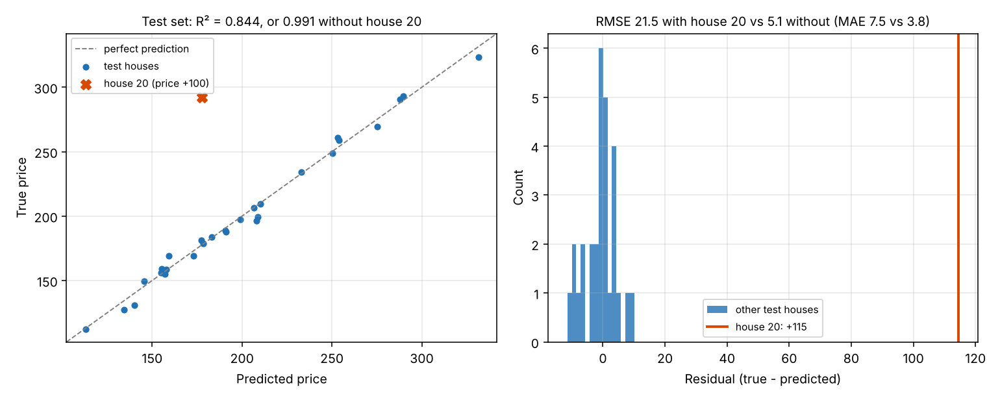

# NumPy House Price Regression

An end-to-end tabular regression pipeline in pure NumPy, with no scikit-learn or pandas:

missing-value imputation → outlier clipping → feature engineering → reproducible train / validation / test split → standardisation → ordinary least squares → evaluation (MAE, RMSE, R², residuals).



## Results

On the synthetic dataset of `scaffold.py` (200 houses; price depends on rooms per household and income, plus Gaussian noise, a few NaNs and one corrupted house), reproduced by `python analysis.py`:

| Split | MAE | RMSE | R² |
| --- | --- | --- | --- |
| Validation | 4.31 | 5.09 | 0.990 |
| Test | 7.53 | 21.50 | 0.844 |
| Test without house 20 | 3.84 | 5.08 | 0.991 |

**One house explains the gap.** The generator adds +100 to the price of house 20, and the random split put it in the test set. Its residual is +115. Squared, that single error dominates the RMSE (21.5 instead of 5.1) and pulls R² from 0.991 down to 0.844. The MAE and the median absolute residual (3.2) barely move. This is why the pipeline reports several metrics: RMSE punishes rare large errors, MAE describes the typical one.

## Pipeline (`model.py`)

| Stage | Functions | Notes |
| --- | --- | --- |
| Cleaning | `impute_nan_with_mean`, `compute_iqr_bounds`, `clip_columns`, `prepare_cleaned_features` | NaNs replaced by column means; values clipped to [Q1 − 1.5 IQR, Q3 + 1.5 IQR] |
| Features | `make_ratio_feature`, `append_column`, `one_hot_encode`, `assemble_feature_matrix` | rooms / households ratio (the true driver of price); one-hot district |
| Split | `make_shuffled_indices`, `partition_indices`, `subset_xy`, `make_train_val_test` | seeded 70 / 15 / 15 split |
| Scaling | `fit_standardizer`, `apply_standardizer`, `add_bias_column`, `standardize_and_add_bias` | statistics fitted on the training set only |
| Model | `ols_fit`, `ols_predict` | least squares with `np.linalg.lstsq` |
| Metrics | `mean_absolute_error`, `root_mean_squared_error`, `r_squared`, `residual_summary`, `evaluate_predictions` | |
| End to end | `house_price_pipeline` | returns parameters, predictions and validation / test metrics |

### Why `lstsq` and not the normal equation

The three one-hot district columns always sum to 1, so together they duplicate the bias column. The training design matrix (140 × 9) therefore has rank 8, and XᵀX is singular (condition number ≈ 3.5 × 10¹⁶). Solving θ = (XᵀX)⁻¹Xᵀy breaks down. `np.linalg.lstsq` goes through the SVD and returns the minimum-norm solution, whose predictions are well defined. The usual alternative is to drop one category (the "dummy variable trap").

### Known limitation

Imputation means and clipping bounds are computed on the whole dataset **before** the split, so a little information about the validation and test houses leaks into training. Fitting them on the training split only, as is already done for standardisation, would remove it.

## Run it

```bash
pip install -r requirements.txt
python scaffold.py     # run the pipeline, print metrics
python analysis.py     # metrics with and without the outlier, figure (--show to display)
```

## Files

```
model.py       my implementation (24 functions)
analysis.py    test-set diagnostics and figure
scaffold.py    driver provided with the exercise
figures/       generated plots
```

---
Guided project from [Deep-ML](https://www.deep-ml.com): the step-by-step structure and `scaffold.py` come from the exercise; every function in `model.py` is my own solution.
